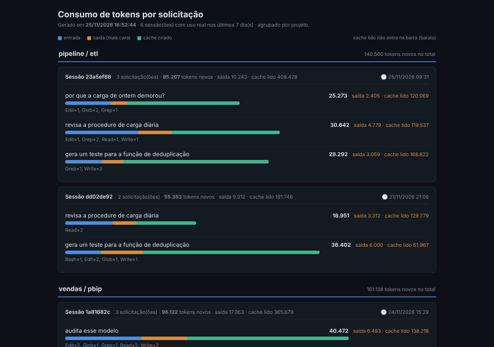

# Token Dashboard para o Claude Code

> 🇺🇸 *A Claude Code skill that builds a local HTML dashboard of token usage per project, session and request, straight from Claude Code's own transcripts. No external API, no extra cost. Docs in Portuguese.*

Uma **skill do Claude Code** que mostra **quanto cada pedido seu consome de tokens**, separado por projeto, sessão e solicitação, com as ferramentas usadas em cada uma. Tudo local: o script só lê os arquivos de transcrição que o Claude Code já salva no seu computador.



*Print gerado com sessões fictícias.*

## O problema

O Claude Code não mostra, de forma simples, quais pedidos gastam mais e por quê. Sem isso, fica difícil saber se um contexto grande está sendo reprocessado à toa, se o cache está sendo reaproveitado ou qual tipo de tarefa pesa mais.

## O que o dashboard mostra

- Tokens de **entrada**, **saída** e **cache criado** em barra colorida, e **cache lido** à parte
- **Ferramentas usadas** em cada solicitação (`Read`, `Bash`, `Edit`…)
- Totais por **sessão** e por **projeto**
- Janela de tempo configurável (últimos N dias)

## Instalação

**Claude Code:** copie a pasta `skill/token-dashboard` para `~/.claude/skills/token-dashboard` (no Windows, `C:\Users\<usuario>\.claude\skills\token-dashboard`).

**claude.ai:** compacte a pasta `skill/token-dashboard` em um `.zip` e envie na área de Skills das configurações. Como o claude.ai não acessa o seu disco, a skill pede que você envie a pasta `~/.claude/projects` compactada.

Requisito: Python 3 no PATH (`python --version`).

## Uso

Dentro do Claude Code, basta pedir: *"atualiza meu dashboard de tokens"*.

Ou rode direto:

```bash
python skill/token-dashboard/scripts/gerar_dashboard.py --out tokens.html --dias 7
```

| Parâmetro | Padrão | Descrição |
|---|---|---|
| `--out` | `tokens.html` | Arquivo HTML de saída |
| `--dias` | `7` | Janela de tempo; sessões mais antigas são ignoradas |
| `--input` | `~/.claude/projects` | Pasta, `.zip` ou `.jsonl` com as transcrições |

## Atualização automática (hook)

Para regenerar o HTML ao fim de cada resposta, adicione um *Stop hook* em `~/.claude/settings.json`:

```json
{
  "hooks": {
    "Stop": [
      {
        "hooks": [
          {
            "type": "command",
            "command": "python /caminho/completo/scripts/gerar_dashboard.py --out /caminho/completo/tokens.html --dias 7"
          }
        ]
      }
    ]
  }
}
```

Use caminho absoluto e barra `/`. Reinicie o Claude Code depois de editar.

## Como ler os números

| Campo | O que é | Custo relativo |
|---|---|---|
| Entrada (azul) | Tokens enviados na chamada, fora do cache | normal |
| Saída (laranja) | Tokens gerados pelo modelo | o mais caro |
| Cache criado (verde) | Contexto novo salvo para reuso | um pouco acima da entrada |
| Cache lido | Contexto reaproveitado de chamada anterior | o mais barato |

**Sinais de desperdício:** cache criado alto sem cache lido crescendo depois (cache que nunca é reaproveitado) e pedidos repetidos em sessões diferentes.

## Como o parsing funciona

- Cada linha do `.jsonl` é um evento; os tokens vêm de `message.usage` nas mensagens do assistente.
- Eventos `user` que só contêm `tool_result` são retorno de ferramenta, não um pedido novo (`is_real_user_prompt()`).
- O nome do projeto é reconstruído a partir do nome da pasta em `~/.claude/projects`, de forma heurística (`decode_project_name()`).

## Limitações

- O formato interno das transcrições é do Claude Code e pode mudar entre versões.
- A reconstrução do nome do projeto é aproximada; pastas com hífen no nome podem sair diferentes.

## Licença

[MIT](LICENSE) · Feito por [Eudes Junior](https://www.linkedin.com/in/eudescj), Analista de Dados.
